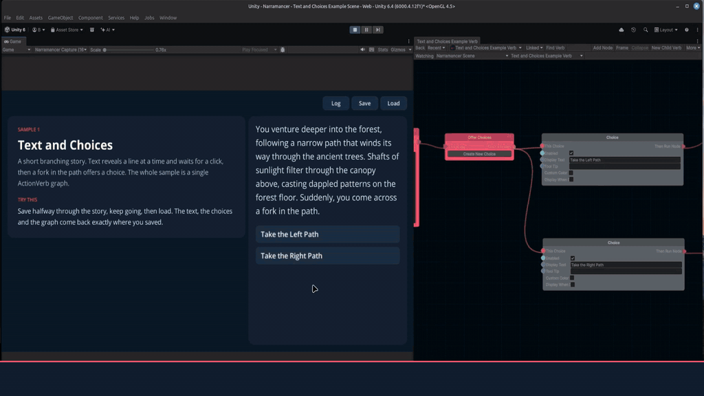

<p align="center">
  
</p>

<h1 align="center">Narramancer</h1>

<p align="center">
  <b>Node graphs for Unity 6 with save and load built in.</b><br>
  Save mid-scene, quit, reload, and every graph picks up on the exact node it was on.
</p>

<p align="center">
  <a href="https://assetstore.unity.com/packages/tools/visual-scripting/narramancer-269301">Asset Store</a> ·
  <a href="https://youtu.be/YOUTUBE_ID">Watch the demo (80 s)</a> ·
  <a href="https://narramancer.com">Documentation</a> ·
  <a href="Assets/Narramancer/Documentation/Getting%20Started.pdf">Getting Started (PDF)</a>
</p>

<p align="center">
  <a href="https://youtu.be/YOUTUBE_ID">
    
  </a>
</p>

Your player saves halfway through a conversation. A character is mid-walk, a timer is counting down, and the
game is waiting on a choice. Most scripting tools can't save that moment: Unity Visual Scripting and Fungus
don't record which step is running, so saving mid-sequence is something you build yourself, or forbid.

In Narramancer, saving is part of how graphs run. Build story, dialogue, quests and NPC behaviour as node
graphs; save at any moment; load, and every graph carries on from exactly where it stopped.

## What gets saved

| Saved automatically | Saved where you add a `Saveable` |
|---|---|
| Every running graph, including what it's waiting on: a click, a choice, a timer, a walk | Position, rotation and scale |
| Every noun (characters, items, places) with its properties, stats and relationships | Sprites, images and text |
| Every variable | Audio, animation and NavMesh agents |
| The text and choices on screen | Whether the object is active, plus your own fields marked `[Save]` |

```csharp
public class Lantern : MonoBehaviour {
    [Save] private float oilLeft = 1f;   // saved and restored with the object, no other code
    [Save] private bool lit;
}
```

Saves point at scene objects by a permanent id, so renaming, reparenting or reordering an object doesn't break
an existing save. Save, quit, relaunch and load has been verified in IL2CPP (WebGL) player builds.

## How it's put together

Narramancer names its parts after grammar:

- **Nouns** are the things in your game: characters, items, places, ideas.
- **Verbs** are what things do, authored as node graphs. An **ActionVerb** runs over time and can wait (for a
  click, a choice, a timer). A **ValueVerb** answers a question instantly. ActionVerbs can use ValueVerbs, but
  not the other way round.
- **Adjectives** are data attached to nouns: **Properties** are tags, **Stats** are numbers, and
  **Relationships** are one-way links between nouns.
- **Variables** are named, typed values, scoped to the whole game, a scene, or a verb.

There are over 150 node types for text, choices, variables, lists, timers, movement, animation and scene
objects, and graphs can be edited in Play Mode while the running node lights up.

## Getting started

1. Import Narramancer from the [Asset Store](https://assetstore.unity.com/packages/tools/visual-scripting/narramancer-269301)
   (or clone this repo; see [Licensing](#licensing)).
2. Open **Window → Narramancer** once to create the settings asset.
3. Open `Narramancer/Scenes/1. Text and Choices Example` and press Play. Save halfway through, keep going, then
   load.

| Sample | What it shows |
|---|---|
| 0. Sample Launcher | A menu that opens the other four |
| 1. Text and Choices Example | Text revealed a line at a time, then a branching choice. Start here. |
| 2. Noun Creation and Destruction | Creating and destroying nouns at runtime |
| 3. Adding and Removing Properties | Changing a noun's properties and reacting to them |
| 4. Character Equipment | Equipment slots from relationships and stats, with UI that verbs update, all saved |

**Requirements:** Unity 6 (built and tested on 6000.4). No package dependencies beyond Unity UI, and no Player
Settings changes. The full guide is the [Getting Started PDF](Assets/Narramancer/Documentation/Getting%20Started.pdf);
every node is documented at [narramancer.com](https://narramancer.com).

**Upgrading from 0.5?** 1.0 changes the save format and replaces the `Serialize…` components with `Saveable`.
Chapter 7 of the Getting Started guide has the steps.

## Licensing

Narramancer is **source-available**: free to read, fork, modify and use for noncommercial projects under the
[PolyForm Noncommercial 1.0.0](LICENSE) license. Using it in anything you sell or monetize, or at work, needs a
license from the [Asset Store](https://assetstore.unity.com/packages/tools/visual-scripting/narramancer-269301).
[`LICENSING.md`](LICENSING.md) explains it in plain language, including the Apache-2.0 terms that still cover
versions released before the change.

Bundled third-party code keeps its own license: [xNode](https://github.com/Siccity/xNode) and
Unity-SerializableDictionary (MIT), and Open Sans (SIL OFL). See
[`Third-Party Notices.txt`](Assets/Narramancer/Third-Party%20Notices.txt).
